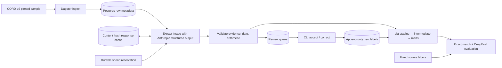

# Receipts into trustworthy warehouse data

Receipt extraction needs an auditable path from image to warehouse row. This
project implements that path with source evidence, rejection rules, human review,
and repeatable evaluation. **The pipeline is verified offline; live model quality
is still pending an API key.** [Results and limitations](docs/results.md) distinguish
measured engineering checks from model results.

| Actual result | Status |
|---|---|
| Fixed CORD sample | 200 receipts downloaded and hash-verified |
| Offline tests | 22 passed, including Postgres review integration |
| Warehouse checks | 5 dbt models and 17 data tests passed |
| Live field accuracy, cost, latency | Pending; no paid calls made |
| Cached demo | Implemented; timing pending genuine response cache |



Every scalar field, including item name, quantity and extended amount, carries
source text/region, confidence, model, and prompt version. Extraction runs are
immutable and content-addressed. Failed arithmetic, absent evidence, invalid
dates, and low confidence enter review. Human corrections create new labels;
they do not rewrite the benchmark or model response. Marts include accepted
outputs and validated corrections; evaluation includes failures too.

Next work: supply the local key, run the bounded live warmup, publish actual
field-level results, and time the cached demo. Independently label merchant/date,
measure confidence calibration, and extend reconciliation for receipts with
service charges/discounts rather than silently relaxing the current rules.

## Run

Requires Python 3.12, uv, and Docker Compose with Postgres 16. Dataset download
requires internet; the quality checks and cache replay require no provider API.

```sh
make setup
cp .env.example .env
make up
make download
uv run receipts ingest
make check
```

The sample is fixed at 200 train receipts using the pinned source revision and
seed in [the public manifest](docs/sample-manifest.json). Raw images, local
annotations, responses, and secrets are ignored. They must never be force-added.

Place `ANTHROPIC_API_KEY` only in the gitignored `.env`; an exported environment
key is deliberately ignored. Before any live run recheck the official model,
structured-output, and pricing links in [results](docs/results.md). Both requested
model IDs are preserved. No model substitutions occur.

```sh
uv run receipts estimate --limit 20
# Explicit paid warmup: only after key and prices are checked.
uv run receipts extract --live --limit 20
uv run receipts validate
uv run receipts dbt
uv run receipts eval --limit 20
make demo
make dagster
```

`make demo` replays 20 cached receipts across the configured variants, builds the
warehouse and evaluates without live calls. Its under-5-minute target is pending
measurement. Run the sample download and paid cache warmup separately. A cache
miss fails explicitly. Dagster also uses cache-only extraction; live warmup is a
separate, visible action. Run `receipts extract --live` for the complete sample
only if its remaining cost fits the authorized cap. The runner stops at $5;
never reset `data/spend.json` to continue spending.

## Review and warehouse development

```sh
uv run receipts queue
# Read raw.extractions.response and raw.receipts.image_path for the queued key.
# Correction JSON follows Receipt.model_json_schema(); preserve evidence/provenance.
uv run receipts review --key RUN_KEY --reviewer local-reviewer --correction data/correction.json
# Omit --correction to accept the existing response after validation.
uv run receipts export-labels --output data/new-labels.json
uv run receipts dbt
```

The CLI rejects invalid corrections and duplicate resolutions. Exports retain
reviewer identity and label history. Full schema and operational tradeoffs:
[engineering notes](docs/engineering.md). The dbt connection uses `PGHOST`,
`PGPORT`, `PGUSER`, `PGPASSWORD`, `PGDATABASE`; Python uses `DATABASE_URL` from the
environment or `.env`. Defaults match Compose. Set both when changing databases.

For API-free CI parity:

```sh
PYTEST_DISABLE_PLUGIN_AUTOLOAD=1 RUN_POSTGRES_TESTS=1 uv run pytest
uv run receipts ci-seed  # explicitly SYNTHETIC rows, never benchmark results
uv run receipts dbt
```

## Data license and attribution

CORD-v2 is distributed by NAVER CLOVA IX on
[Hugging Face](https://huggingface.co/datasets/naver-clova-ix/cord-v2), with
[dataset metadata](https://huggingface.co/datasets/naver-clova-ix/cord-v2/blob/main/dataset_infos.json)
identifying **Creative Commons Attribution 4.0 International**. The authoritative
[CORD repository](https://github.com/clovaai/cord) and
[dataset license](https://github.com/clovaai/cord/blob/master/LICENSE-CC-BY)
confirm the terms. License verified before download; see the verification date
in [results](docs/results.md). Attribution: Park et al., *CORD: A Consolidated
Receipt Dataset for Post-OCR Parsing*, NAVER CLOVA. This project converts labels
for evaluation and samples receipt metadata; it does not redistribute raw images.
Retain attribution and license links for downstream derived datasets.
