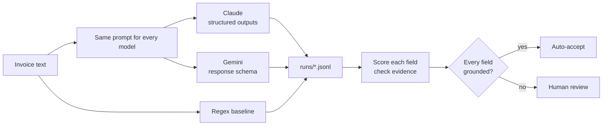

# llm-extraction-evals

[](https://github.com/ecuadrosg36/llm-extraction-evals/actions/workflows/ci.yml)

**Pull structured data out of documents with an LLM, and know when you can trust it.**

Each extracted field comes with the exact text it was taken from. The eval scores every field against known
answers, checks that the evidence really appears in the document, and decides which documents can skip human
review. Claude and Gemini plug in behind the same interface, next to a regex baseline.

## Why

Getting JSON out of an LLM is easy. Knowing whether to trust it is the hard part:

- A model can return a clean, valid value that is simply wrong: the customer's tax ID instead of the seller's,
  or the subtotal instead of the total.
- Accuracy on average hides *which* documents are wrong. In production, what matters is: **if nobody reviews
  this document, how often is it fully right?**

## What it measures

| Metric | Question it answers |
|---|---|
| Field accuracy | How many fields match the answer, after normalizing format (`1.234,50` = `1234.50`) |
| Values backed by exact evidence | Did the model quote text that really is in the document, or make it up? |
| Auto-accepted | Documents where every required field has a value with real evidence: no review needed |
| **Auto-accepted that are fully correct** | The number to watch: the error rate nobody will see |
| Wrong documents caught by review | Of the documents with a mistake, how many were sent to a person |

## The dataset

60 generated invoices in 4 layouts ([`data/invoices.jsonl`](data/invoices.jsonl)), each with traps real
documents have:

| Layout | Trap |
|---|---|
| `us` | The customer's tax ID is printed before the seller's; subtotal and tax appear before the total |
| `peru` | Day-first dates (`04/03/2026`), `1.234,56` amounts, two RUC numbers |
| `mexico` | No due date at all, so the right answer is `null` |
| `email` | Free text that also mentions an older invoice's amount |

Every company, ID and amount is made up. The generator is seeded, so the file is the same on every machine, and
a test fails if the committed file drifts from the generator.

## Results so far

```text
| | `baseline-regex` |
|---|---:|
| Field accuracy (all fields)              | 85.7% |
| Documents fully correct                  | 25.0% |
| Values backed by exact evidence          | 96.4% |
| Auto-accepted (no review)                | 75.0% |
| Auto-accepted that are fully correct     | 33.3% |
| Wrong documents caught by review         | 33.3% |
```

The regex baseline looks fine at 86% field accuracy, yet only 1 in 4 documents is fully right, and two thirds
of the documents it would auto-accept are wrong. Its evidence is real text, just the *wrong* text. That's
why the eval checks correctness and evidence separately, and why the baseline is the bar the LLMs must beat.

**Claude and Gemini runs are not committed yet.** They need an API key; see below. Once a run file is in
`runs/`, CI re-scores it on every push without calling any API.

## Run it

```bash
uv sync
uv run evals run --extractor baseline

# Claude (default model claude-opus-5-5); reads ANTHROPIC_API_KEY or an `ant auth login` profile
uv sync --extra claude
uv run evals run --extractor claude

# Gemini; reads GEMINI_API_KEY
uv sync --extra gemini
uv run evals run --extractor gemini --model <gemini model id>

uv run evals score runs/*.jsonl                          # compare every saved run, side by side
uv run evals gate runs/claude.jsonl --min-accuracy 0.95  # exit 1 below the bar, for CI
```

A full run is 60 short requests.

## How it works



- **Schema first.** [`InvoiceExtraction`](src/extraction_evals/schema.py) is a Pydantic model where every
  field is `{value, evidence}`. Claude gets it through `messages.parse(output_format=...)` and Gemini through
  `response_schema`, so both return validated objects, not text to clean up.
- **One prompt for all models** ([`prompt.py`](src/extraction_evals/extractors/prompt.py)), so differences in
  score come from the model.
- **Failures don't stop a run.** API errors, refusals and truncated output become an empty extraction and are
  logged with the document ID. Empty fields are never auto-accepted.
- **Runs are saved, then scored.** Raw output goes to `runs/*.jsonl`; scoring is a separate step, so you can
  change the scoring rules and re-score old runs for free.
- **Scoring compares meaning.** Amounts within half a cent, dates as ISO, tax IDs without punctuation, names
  without case or extra spaces ([`normalize.py`](src/extraction_evals/normalize.py)).

## Next

- Commit Claude and Gemini runs and compare them with the baseline.
- Use the model's evidence to locate the value's position in the document, and highlight it in a review UI.
- Add scanned PDFs, so the eval also covers OCR noise.

## Development

```bash
uv sync
uv run pytest     # 29 tests, ~97% coverage; LLM adapters are tested with fake clients
uv run ruff check src tests
```

MIT License.
